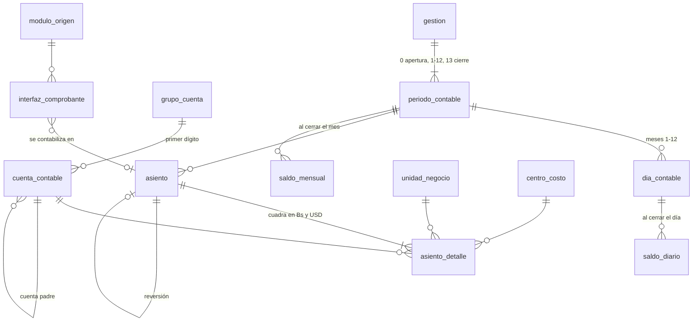

# Contabilidad en PostgreSQL (reemplazo del módulo `cn` del SAI)

Esquema `contabilidad` con plan de cuentas, asientos, interfaz con los módulos de origen y **cierres diario, mensual y anual**, más la migración de los datos del SAI (Informix `tbsai@online09`). El diseño sale del funcionamiento real del módulo `cn`, documentado en [docs/sai_informix/contabilidad.md](../../../docs/sai_informix/contabilidad.md).

**Estado: propuesta, no aplicada en ningún servidor.** Se instaló y probó completa en un PostgreSQL 9.5.25 desechable (la versión de bazinga), con las dos pruebas de `pruebas/` sin fallas. Falta decidir en qué base va (ver [Decisiones pendientes](#decisiones-pendientes)).

## Archivos

| Archivo | Contenido |
|---|---|
| [`instalar.sql`](instalar.sql) | Corre los scripts en orden con `psql` y se detiene en el primer error |
| [`migraciones/001_estructuras.sql`](migraciones/001_estructuras.sql) | Esquema, catálogos, plan de cuentas, gestión/período/día, asientos, interfaz, saldos, bitácora y vistas |
| [`migraciones/002_reglas_y_registro.sql`](migraciones/002_reglas_y_registro.sql) | Triggers de integridad (cerrados, cuadre diferido, interfaz contabilizada) y `registrar_asiento`, `anular_asiento`, `contabilizar_interfaz` |
| [`migraciones/003_cierres.sql`](migraciones/003_cierres.sql) | `crear_gestion` y los cierres y reaperturas de día, período y gestión |
| [`migraciones/004_reportes.sql`](migraciones/004_reportes.sql) | Libro diario, libro mayor, sumas y saldos, balance general, estado de resultados y control de descuadres |
| [`migraciones/005_permisos.sql`](migraciones/005_permisos.sql) | Roles `contabilidad_consulta`, `_operador`, `_supervisor` e `_interfaz` |
| [`migraciones/006_migracion_sai.sql`](migraciones/006_migracion_sai.sql) | Staging `contabilidad_sai` (copia de las tablas del SAI), `migrar_desde_sai` y `ajustar_asiento_migrado` |
| [`pruebas/prueba_ciclo_contable.sql`](pruebas/prueba_ciclo_contable.sql) | 54 controles del ciclo completo (termina en `ROLLBACK`) |
| [`pruebas/prueba_migracion_sai.sql`](pruebas/prueba_migracion_sai.sql) | 23 controles de la migración con un SAI en miniatura (termina en `ROLLBACK`) |

Requiere PostgreSQL **9.5 o superior**: no usa `CREATE PROCEDURE` (llegó en la 11) sino funciones `plpgsql`, que corren igual en versiones nuevas.

## Modelo



| Tabla nueva | Viene del SAI | Para qué |
|---|---|---|
| `moneda`, `tipo_cambio` | `cmon`; tipo de cambio por línea (`cndtrcamb`) | Bs (funcional) y USD; tipo de cambio oficial por fecha |
| `unidad_negocio`, `centro_costo`, `grupo_centro_costo`, `unidad_negocio_centro_costo` | `cnune`, `cncco`, `cncsu`, `cnruc` | Proyectos y centros de costo permitidos |
| `tipo_documento`, `modulo_origen` | `cntdc`, `morg` / `modn` | Clase de comprobante y módulo que lo genera |
| `tipo_auxiliar`, `auxiliar_contable` | `cntco` / `cnhtc`, `cncnp` / `cnhcn` (`tcon`, `ncon`) | Análisis adicional de una cuenta |
| `grupo_cuenta`, `nivel_cuenta`, `cuenta_contable` | `cnprmncp1..9`, `cnplc` | Plan de cuentas 1-3-5-8 dígitos con naturaleza y saldo normal |
| `cuenta_contable_gestion` | `cnpch` | Foto del plan al cerrar cada gestión |
| `gestion`, `periodo_contable`, `dia_contable` | `cocierre` + `cnprm`/`cnhpr`, `coperiodo`, — | Calendario y estado de cada cierre (el cierre diario no existía) |
| `asiento`, `asiento_detalle` | `cnhtr`/`cndtr` y el histórico `cnhht`/`cnhdt` | Un solo libro para todas las gestiones (sin tablas de histórico aparte) |
| `interfaz_comprobante` | `cntcn` (lo que escribe `pins_cntcn`) | Líneas que dejan cobros, reservas, caja y tesorería para contabilizar |
| `saldo_diario`, `saldo_mensual` | — (`cnhmc` estaba vacía) | Movimiento por día y saldo por mes, cuenta, unidad y centro |
| `correlativo_asiento`, `bitacora_cierre` | `cnsrl` / `cnhsr` | Numeración sin huecos y auditoría de cierres y reaperturas |

## Reglas

- **Importes con signo**, como en el SAI: positivo es debe y negativo es haber, en `importe_bs` e `importe_usd`. La vista `v_asiento_detalle` y los reportes los muestran separados en debe y haber.
- **Cuadre** (regla de `pcuadre_cntcn`): en la moneda de la operación el asiento suma 0 exacto. En la otra moneda, una diferencia menor a la tolerancia de la gestión (0,80) se lleva automáticamente a la cuenta de redondeo (`50201030`). Además, un trigger diferido rechaza al confirmar cualquier asiento que no sume cero.
- **Cerrados**: un día, período o gestión cerrado no admite altas, cambios ni bajas. Los asientos nunca se borran:
  - si su día está abierto, se **anulan** y dejan de contar;
  - si el día está cerrado, se **revierten** con un asiento inverso en un día abierto de la misma gestión.
- **Interfaz**: el cierre diario arma un asiento por módulo y documento. Un documento descuadrado queda en `ERROR` con su motivo y no frena a los demás. Lo contabilizado ya no se toca.
- **Validaciones de los asientos manuales**:
  - las cuentas tienen que ser imputables y estar activas;
  - el centro de costo es obligatorio si la cuenta lo exige (`cnplcmcco`);
  - el centro tiene que estar habilitado para la unidad de negocio;
  - el asiento necesita al menos dos líneas.
- **Usuario**: cada función recibe `p_usuario`, que es el usuario de la aplicación. Corren como dueño del esquema (`SECURITY DEFINER`), así que `current_user` no sirve para auditar.

## Operación

### Alta de una gestión
```sql
SELECT contabilidad.crear_gestion(2027, 'contador');   -- copia cuentas y opciones de 2026
UPDATE contabilidad.gestion SET revaluar_moneda_extranjera = true WHERE gestion = 2027;
```
`cerrar_gestion` crea la gestión siguiente si no existe.

### Registro
```sql
SELECT contabilidad.registrar_asiento('2027-03-15', 1, 'COBRO DE CUOTA',
  '[{"codigo_cuenta":"10101011","importe_usd":500,"codigo_unidad_negocio":406},
    {"codigo_cuenta":"10204011","importe_usd":-500,"codigo_unidad_negocio":406}]',
  'cajero1', 40, 9001, 2);   -- módulo, documento, moneda de la operación (2 = USD)
SELECT contabilidad.anular_asiento(1234, 'contador', 'cargado dos veces');
```

### Cierre diario
Lo puede correr cada noche Pentaho o cron:
```sql
SELECT * FROM contabilidad.cerrar_dias_pendientes(current_date - 1, 'etl');
```
Cierra en orden los días abiertos y los que tienen interfaz pendiente. En cada día contabiliza la interfaz, controla el cuadre, calcula `saldo_diario` y bloquea el día. Se detiene en el primer día que no cierra; el motivo queda en el resultado y en `interfaz_comprobante.mensaje_error`.

### Cierre mensual
```sql
SELECT contabilidad.cerrar_periodo(2027, 3, 'contador');
```
Exige el mes anterior cerrado, todos los días cerrados y la interfaz contabilizada. Si la gestión tiene `revaluar_moneda_extranjera`, ajusta al tipo de cambio del último día del mes el saldo en Bs de las cuentas de activo y pasivo en USD, contra `codigo_cuenta_diferencia_cambio`. Al final calcula `saldo_mensual`.

Enero **no** espera la apertura: el cierre anual suele hacerse meses después, por la auditoría. Cuando se genera la apertura, los meses ya cerrados de la gestión nueva se recalculan solos.

### Cierre anual
```sql
SELECT contabilidad.cerrar_gestion(2026, 'contador');          -- p_traspasar_resultado = true
```
1. Exige los 12 meses cerrados.
2. **Asiento de cierre** (período 13): lleva las cuentas de ingreso y gasto a cero contra `30402010 RESULTADO DE LA GESTION`, por unidad de negocio.
3. Guarda la foto del plan de cuentas.
4. **Apertura** de la gestión siguiente (período 0) con los saldos de balance y de orden. El resultado abre en `30401010 RESULTADOS ACUMULADOS`; con `false`, en la misma cuenta de resultado.

### Reaperturas
Piden motivo y quedan en `bitacora_cierre`.

| Función | Condición | Qué deshace |
|---|---|---|
| `reabrir_dia(fecha, usuario, motivo)` | el mes está abierto | — |
| `reabrir_periodo(gestión, mes, usuario, motivo)` | el mes siguiente está abierto | anula la revaluación del mes |
| `reabrir_gestion(gestión, usuario, motivo)` | la gestión siguiente no está cerrada | anula el cierre y la apertura |

### Reportes
```sql
SELECT * FROM contabilidad.libro_diario('2027-03-01', '2027-03-31');
SELECT * FROM contabilidad.libro_mayor('10101011', '2027-01-01', '2027-03-31');        -- también cuentas de nivel superior
SELECT * FROM contabilidad.balance_sumas_saldos(2027, 3, NULL, 4);                     -- gestión, hasta el mes, unidad, nivel
SELECT * FROM contabilidad.balance_general(2027, 3);
SELECT * FROM contabilidad.estado_resultados(2027, 1, 3, 406);                          -- por proyecto
SELECT * FROM contabilidad.asientos_descuadrados();
```

## Seguridad

| Rol | Puede |
|---|---|
| `contabilidad_consulta` | Leer tablas y reportes |
| `contabilidad_operador` | Lo anterior, más registrar y anular asientos, contabilizar la interfaz, cerrar días, cargar tipos de cambio y corregir líneas de interfaz con error |
| `contabilidad_supervisor` | Lo anterior, más catálogos y plan de cuentas, crear gestiones, cierres mensual y anual, todas las reaperturas y ajustar asientos migrados |
| `contabilidad_interfaz` | Solo insertar en `interfaz_comprobante` (ETL o módulos) |

- Nadie escribe directo en asientos, saldos ni calendario: todo pasa por las funciones.
- Los roles no tienen login; se asignan con `GRANT contabilidad_operador TO <usuario>`.
- El esquema lo tiene que poseer un usuario técnico propio, no `gel` (que es superusuario).
- Probado: un operador registra y consulta, pero no puede escribir en `asiento`, cerrar meses ni migrar.

## Migración desde el SAI

1. **Instalar** el esquema en la base destino (`instalar.sql`).
2. **Cargar el staging** `contabilidad_sai`: tiene las mismas tablas y columnas que el SAI. Con Pentaho alcanza una transformación con un *Table input* (`PRD SAI09`) y un *Table output* por tabla, sin transformar nada, como las consultas de solo lectura que ya se usaron para documentar el SAI. Volumen aproximado: 216 mil líneas en `cndtr`, 48 mil en `cnhdt`, 856 mil glosas en `cndtrglo` y 430 mil líneas en `cntcn`.
3. **Migrar** en una transacción y revisar el informe antes de confirmar:
   ```sql
   BEGIN;
   SELECT * FROM contabilidad.migrar_desde_sai('migracion');
   SELECT * FROM contabilidad.asientos_descuadrados();
   COMMIT;
   ```
4. **Corregir los descuadres** heredados. En el SAI hay un asiento de 2023 descuadrado en 17.623.005,98 Bs: la misma diferencia que el borrador de apertura de la gestión 0. Mientras no se corrija, la apertura de 2024 no cuadra y el cierre de 2023 se rechaza. Se corrige con `ajustar_asiento_migrado`: reabrir los meses desde el del asiento, agregar las líneas que acuerde contabilidad y volver a cerrar.
5. **Cerrar 2023, 2024 y 2025 en orden** con `cerrar_gestion`. Desde 2023 el SAI no generó asientos de cierre ni de apertura. Hasta entonces los balances de 2024 en adelante muestran los saldos de balance sin arrastre.

Qué hace la migración con cada caso, según lo encontrado en el SAI:

| Caso en el SAI | En la base nueva |
|---|---|
| 2018-2022 en `cnhht`/`cnhdt` (`cper` = 0) | Gestiones cerradas; el mes se toma de la fecha del documento |
| 2023-2026 en `cnhtr`/`cndtr`; `coperiodo` B/A | Gestiones abiertas, meses cerrados o abiertos como en `coperiodo` |
| `cper` = 0 en la gestión abierta (apertura de 2023) | Período 0 |
| Asiento con `mrcb` = 9 | `ANULADO`, con sus líneas |
| Línea con `mrcb` = 9 en un asiento vigente | No se migra (se informa) |
| `cndtr` de la gestión 0 (borrador de apertura de 2024, descuadrado) | No se migra (se informa) |
| `cntcn` con `post` = 0 | En la interfaz: `PENDIENTE` si su mes está abierto, `DESCARTADO` si está cerrado |
| Códigos usados en movimientos que faltan en los catálogos | Se crean inactivos con "(SAI, SIN DESCRIPCION)" |
| Glosas | `cndtrglo` → glosa de la línea; `cnglo`/`cnhgl` → glosa del asiento |

Mientras los otros módulos sigan en el SAI, se pueden seguir contabilizando con un proceso de ETL que copie cada día el `cntcn` pendiente a `interfaz_comprobante`, con el rol `contabilidad_interfaz`.

## Pruebas

En una base de prueba (nunca en producción) con `instalar.sql` aplicado:
```
psql -d <base_de_prueba> -f sql/postgres/contabilidad/pruebas/prueba_ciclo_contable.sql
psql -d <base_de_prueba> -f sql/postgres/contabilidad/pruebas/prueba_migracion_sai.sql
```
Cada control imprime `ok ...` y ambas terminan con `ROLLBACK`. Resultado al 17/10/2026 en PostgreSQL 9.5.25: 54 y 23 controles sin fallas.

## Decisiones pendientes

- **Base y servidor destino.** Puede ser una base nueva (recomendado: la contabilidad no debería compartir base con el ETL) o bazinga.
- **Revaluación mensual de la moneda extranjera.** Hay que confirmar con contabilidad si se aplica y qué tipo de cambio es el oficial; viene apagada.
- **Nombres de los módulos de origen** (2, 4, 9, 12, 13, 40, 96). Se dedujeron de los tipos de documento: confirmarlos.
- **Gestión calendario** (enero a diciembre, como en el SAI). `crear_gestion` admite otro mes de inicio si hiciera falta.

## Desinstalar (solo en una base de prueba)

```sql
DROP SCHEMA contabilidad_sai CASCADE;
DROP SCHEMA contabilidad CASCADE;
DROP ROLE contabilidad_interfaz, contabilidad_supervisor, contabilidad_operador, contabilidad_consulta;
```
